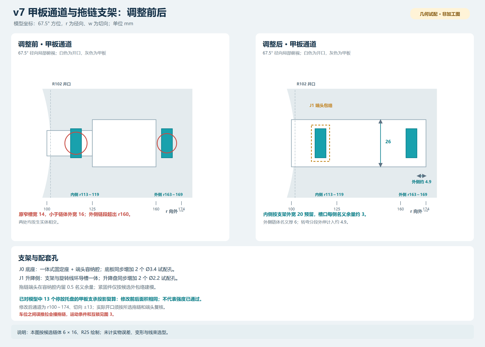
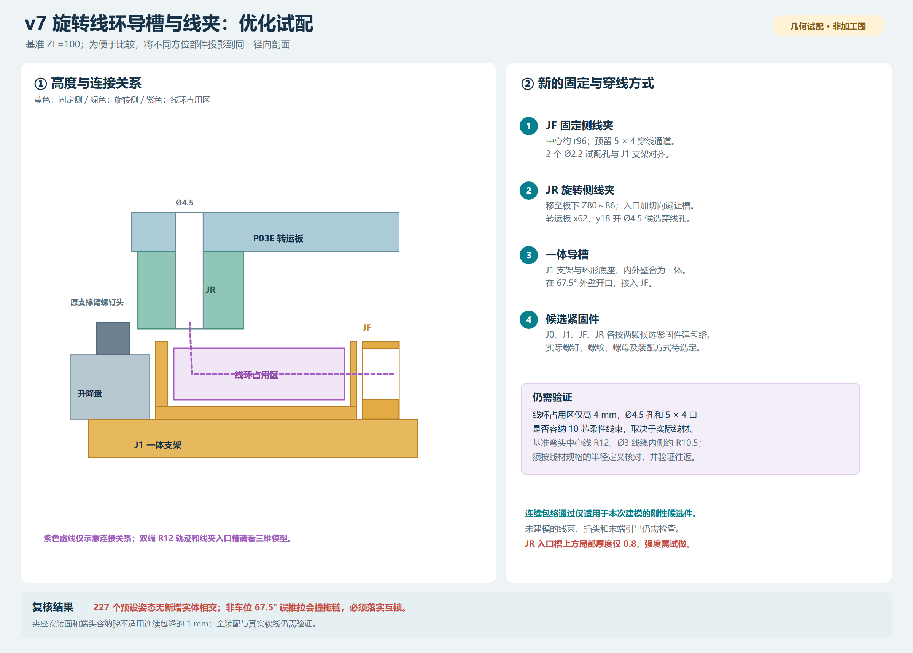
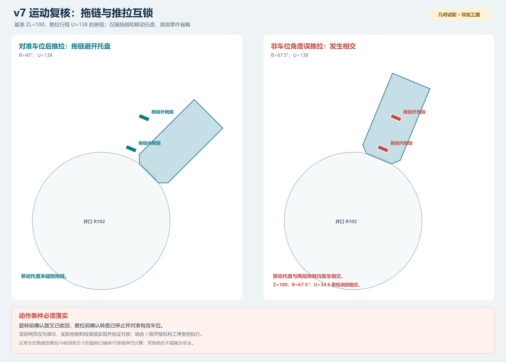

# v7 走线优化：装配、通道和运动复核

日期：2026-11-07。根据初版走线试配的干涉检查结果，调整两层甲板通道、拖链支架、旋转导槽与线夹，并另存了三维模型。**正常动作受限时，建模的新增实体在采样姿态下未发现相交；但非车位角度误推拉会撞拖链，实际线材和机构仍未验证，本文件不是加工图。**

## 查看文件

| 文件 | 内容 |
|---|---|
| [优化后三维装配 DWG](./车库_v7_走线优化_双端R12.dwg) | 350 个装配实体，基准姿态 ZL=100、θ=0；`W_LOOP_PATH` 是双端 R12 示例线，非真实电缆 |
| [优化后三维实体 SAT](./车库_v7_走线优化_双端R12.SAT) | 350 个基准实体；不含示意线、运动约束，SolidWorks 未实测 |
| [离线三维预览](./走线三维预览_双端R12.html) / [预览图](./走线三维预览_双端R12.png) | 浏览器旋转、缩放和显隐；仅展示 62 个重点实体，不能替代完整 DWG |
| [甲板通道与支架对照 PNG](./01_甲板通道与支架_优化对照.png) / [SVG](./01_甲板通道与支架_优化对照.svg) | 原槽口、调整后槽口、拖链支架和配套孔 |
| [旋转导槽与线夹 PNG](./02_旋转导槽与线夹_优化方案.png) / [SVG](./02_旋转导槽与线夹_优化方案.svg) | 线环占用区、JF/JR 固定点和穿线位置 |
| [运动互锁风险 PNG](./03_运动互锁与拖链_风险示意.png) / [SVG](./03_运动互锁与拖链_风险示意.svg) | 正常车位角度与非车位角度误推拉对比 |
| [姿态覆盖](./姿态_覆盖.csv)、[相交记录](./姿态_实体相交.csv)、[统计](./检查统计.json) | 227 条预设姿态的实体运算记录；相交记录为空表示这些姿态无体积相交 |
| [连续包络实体检查](./关键零件_连续包络实体检查.csv)、[推拉连续净空下界](./推拉动作_连续几何下界.csv) | 针对指定对象的保守全行程检查 |
| [非车位角度推拉相交](./非车位角度_推拉相交.csv)、[覆盖情况](./非车位角度_推拉覆盖.csv) | θ=67.5°、ZL=100 的额外测试，存在相交 |
| [Ø3 线环空间探针覆盖](./线环Ø3_双端R12_空间探针覆盖.csv)、[相交记录](./线环Ø3_双端R12_空间探针相交.csv) | 假设单根线束外径 3、示意弯头 R12 的空间检查，不代表实际线材已选定 |
| [托盘支承投影](./甲板_托盘支承投影.csv)、[新增孔](./新增孔_移除体积.csv)、[文件重开验证](./验证_双端R12重开.txt) | 支承投影对比、候选孔和 AutoCAD 重开结果 |

DWG 图层：`W_CHAIN` 为简化拖链，`W_BRACKET` 为 J0、J1 支架及一体导槽，`W_CLAMP` 为 JF/JR 线夹，`W_FASTENER` 为候选螺钉头和轴杆包络，`W_CABLE_ENVELOPE` 为线环占用区，`W_LOOP_PATH` 为基准示意线。原 v7 文件和二维图纸没有覆盖；**旧 P02S、P03E、P05R、P06R、P07R 图纸不包含本次开孔或改口，不能直接对应本模型加工**。

## 一、调整内容

以底板上表面为 Z=0，ZL 为中央托盘支撑高度。以下尺寸均为 mm，保持升降 ZL=86～194、转盘 θ=−135°～+180°、拨叉推拉 0～138 的试配范围。

| 部位 | 新方案 |
|---|---|
| 两层甲板 | 67.5° 方位新减去 `r=100～174、w=−13～+13` 的通道，并与原 R102 井口及已有口袋连通。候选链体为径向厚 6、切向宽 16、弯曲中心线 R25；实际链体及端头确定后须复核。 |
| J0 固定端 | 底脚、立架和端头容纳腔合为一体；底脚及底板在 `r=162、w=±8` 增加两处 Ø3.4 候选孔。固定链段位于 r=163～169，容纳腔在径向和切向各留约 0.5 名义间隙。 |
| J1 移动端 | 支架与环形导槽底板、内外壁合为一个候选实体；升降盘和支架在 `r=52、w=±3` 增加两处 Ø2.2 候选孔。移动端容纳腔对简化链段的名义余量约 0.5。 |
| 一体导槽 | 基准姿态底板 `r=59～92、Z=73～74`，内壁 `r=59～61`、外壁 `r=91～92`、高度 Z=74～79；外壁在 67.5° 方向开口。候选线环占用区 `r=62～90、Z=74.5～78.5`。 |
| JF 固定夹 | 约在 r=93～99、Z=73～79；沿径向留 5×4 候选通道，支架与线夹有两处 Ø2.2 对应孔。 |
| JR 旋转夹 | 位于转运板下方，基准包络 `x=55～69、y=11～25、Z=80～86`。转运板及线夹在 `(x=62,y=18)` 开 Ø4.5 候选穿线孔，在 `(58,14)` 和 `(66,22)` 各开 Ø2.2 候选安装孔。线夹下方增加切向避让槽，以试配 R12 入孔弯头。 |
| 候选紧固件 | J0、J1、JF、JR 各画两颗候选螺钉的头部和轴杆空间，共 16 个实体；尺寸为试配包络，实际螺钉、螺母、螺纹、长度和锁紧方式仍需确定。 |

13 个已建模停放托盘的甲板支承投影面积在改口前后均为 7121.1746 mm²，变化为 0；该比较只说明平面投影，没有计算承载、变形和疲劳。两层甲板各移除约 3230.32 mm³ 材料，需另做强度和实际托盘接触验证。

## 二、运动和干涉结果

### 1. 实体采样及关键连续包络

对拖链、新支架、导槽、线夹、线环占用区和候选紧固件与原模型、以及新增件之间做 AutoCAD 实体检查：**227 条预设姿态记录均无体积相交**，包括 8 个高度、8 个常规角度、5 个推拉位置及两个靠近原支撑臂螺钉的额外角度。部分姿态重复；其中两个姿态清空缓存后重新逐对计算，结果一致。

在上面基础上，对以下包络额外扩大至少 1 mm，并在相应完整范围内与指定对象做实体相交检查：

- 简化拖链对 149 个静止原件；J1 支架 / 导槽及 JF 候选件对这些静止原件。
- JR 线夹及其候选紧固件绕轴全圆转动，对 74 个随升降但不旋转的实体；JR 线夹及紧固件的全升降、全圆包络对 149 个静止原件。

这五组共 **670 条对象检查均无相交**，因此仅对这些对象对和假设形状，可得到至少 1 mm 的名义间隙下界。端头与容纳腔、螺钉与安装孔、安装接触面等不属于此 1 mm 结论；例如链端容纳腔只有约 0.5 名义余量。

对拖链与推拉件另外进行了连续几何包络计算：在八个常规车位角度，覆盖完整推拉行程的**扩大的拖链包络**与推拉件最小下界为 3.8923；拨叉收回时覆盖全转角的下界为 19.4728。JR 线夹及其候选紧固件相对于推拉件的全行程下界为 3.5。这些都是模型与所列对象范围内的保守下界，并非整机通用间隙。

### 2. 必须落实的动作互锁

额外检查发现，在 **ZL=100、θ=67.5°** 这个车位之间的位置，若继续推拉：U=34.5 时中央托盘已经与内侧拖链实体相交；U=138 时托盘和载车包络与两条链段相交。因此不能把八个车位角度的推拉结果推广为任意转角安全。

现有[网页演示状态机](../simulation.js)要求旋转前拨叉收回，伸出前对准车位；它只是演示，不代表真实控制器已经具备互锁。实际设备应实现并验证位置确认、停转后对准车位再推拉、拨叉确认收回后再旋转等动作条件；啮合 / 脱开所需升降应按机构工序受控执行。

### 3. 检查边界

227 条结果是预设姿态的实体运算，不是所有转角、升降、推拉任意组合的精确连续求解。全行程轴对齐包络还保留 1682 对可能重叠的候选，其中包括不可能同时发生的组合；重叠不等于碰撞。非车位角度误推拉的实际碰撞已单独列出。原 v7 零件之间的全部干涉、其他装载状态和真实运动状态机未完整复核。

最终双端 R12 模型是在上述刚性复核模型的 JR 线夹上**仅做布尔减料**得到；其余实体体积未变化，线夹减料体积与生成记录一致。因此原较大线夹的无相交结果可作为新线夹的保守结论。最终 DWG 和 SAT 已在 AutoCAD 重开，均为 350 个装配实体；DWG 另有一条示意线。

## 三、旋转线环的实际限制

为了检验空间，另画了一条基准姿态下的平滑示意线：两端过渡中心线半径 **R12**，并假设整束线缆外径 **Ø3**。基准姿态的环形空间、JF 入口、JR 穿板出口和两端弯头共做了 138 组保守空间探针检查，未与被检查的实体相交；对选定运动对象也做了全角度 / 全升降包络检查。基准多段线中，沿线相距至少 9 mm 的非局部段最小中心距约 7.14；这只是静态几何检查。

**这不是实际 10 芯线束已可用的证明。**真实线束外径必须与 Ø3 假设相符。R12 是基准示意线的**中心线半径**，若线缆外径为 3，其内侧弯曲半径约为 R10.5；必须确认厂家额定的最小动态弯曲半径是按中心线还是内侧定义，并按对应位置核对。即使基准姿态满足，往返过程中也可能弯得更紧，仍需验证。线环随 −135°～+180° 往返的收放、自接触、脱槽、磨损和寿命没有做柔性仿真；图中示意线约 842 mm 仅为基准中心线长度，不能作为裁线长度。若实际线径或弯曲半径不满足，应重新设计导槽、轴系叠层或选择合适的旋转连接方案。

JR 的切向入口槽使其上方局部名义壁厚仅约 **0.8 mm**；该区域的制造方式、刚度、夹持和耐久必须先做小样试验。导槽盖板、边缘护口、接头、传感器座、尾线固定和应力释放尚未设计。实际紧固件及甲板/支架强度、运动误差、载荷、失电防坠和实机互锁也尚未验证。

复现入口：`tools/redesign_wiring_assembly_v7.ps1 -OutputDir <新目录>` 生成初始优化实体与姿态记录；`tools/check_double_r12_wiring_v7.ps1 -Folder <该目录>` 对 JR 减料、检查 Ø3 示例通路并生成双端 R12 文件；`py tools/check_wiring_motion_analytics_v7.py` 检查本交付目录中的连续几何下界。图像脚本为 `tools/draw_redesigned_wiring_v7.py` 和 `tools/render_redesigned_wiring_v7.py`。这些结果均属于几何试配。
