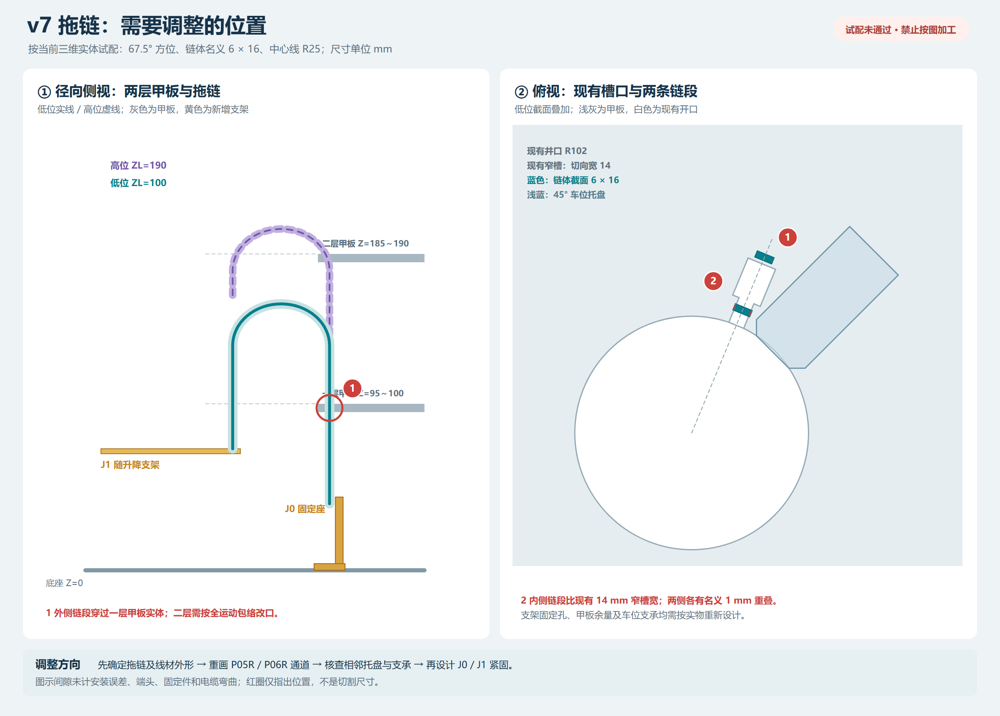
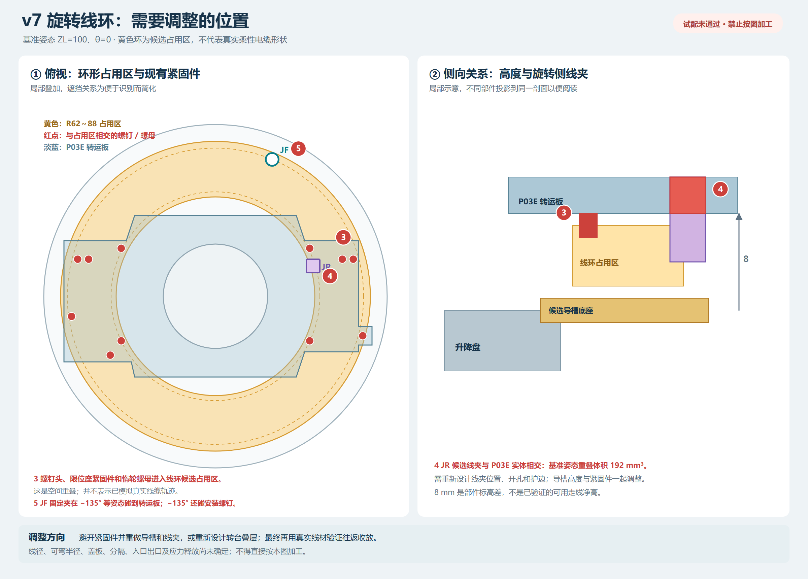

# v7 拖链、支架和旋转线环：三维试配与干涉复核

日期：2026-11-07。以原 [v7 三维装配](../三维装配_v7_加厚夹带/README.md) 为基础，新增候选拖链、固定架、移动架、旋转线环导向和两端线夹。**本方案存在已确认的实体相交，尚未通过，不能用于加工或采购。**原 v7 文件未覆盖。

后续已按本报告调整两层通道、支架、导槽和线夹，并补查运动边界；请查看[走线优化与安装复核](../三维装配_v7_走线优化安装复核/README.md)。

## 查看文件

| 文件 | 内容 |
|---|---|
| [三维装配 DWG](./车库_v7_走线候选_含示意线.dwg) | AutoCAD 实体模型，基准姿态为 ZL=100、θ=0；带线环示意线及基准相交体 |
| [三维实体 SAT](./车库_v7_走线候选.SAT) | 基准姿态的 340 个装配实体，不含相交体或示意线；无装配运动约束 |
| [离线三维预览](./走线三维预览.html) / [预览图片](./走线三维预览.png) | 浏览器可旋转和显隐部件；只含 52 个重点实体，不是运动仿真 |
| [拖链、支架调整图 PNG](./01_拖链与支架_调整位置.png) / [SVG](./01_拖链与支架_调整位置.svg) | 两层甲板的拖链通道、J0、J1 和两处相交位置 |
| [旋转线环调整图 PNG](./02_旋转线环_调整位置.png) / [SVG](./02_旋转线环_调整位置.svg) | 旋转侧线夹、固定侧线夹与板件、紧固件的关系 |
| [各姿态实体相交记录](./姿态_实体相交.csv)、[姿态覆盖](./姿态_覆盖.csv) | 检查到的新增件对原件、以及新增件之间的相交 |
| [全行程保守包络候选](./全行程_保守包络候选.csv) | 整段运动范围内包络可能重叠的对象对；重叠**不等于**已确认碰撞 |
| [装配清单](./装配清单.csv)、[检查统计](./检查统计.json)、[DWG/SAT 重开验证](./验证_重开.txt) | 基准实体位置、检查数量和文件重开结果 |

DWG 中，`W_CHAIN` 为拖链，`W_BRACKET` 为支架，`W_CLAMP` 为线夹，`W_GUIDE` 为旋转线环导向件，`W_CABLE_ENVELOPE` 为旋转线环的**占用区**。`W_LOOP_PATH` 是基准姿态从 JF 至 JR 的无厚度三维示意线，仅用于辨认连接关系，未参与实体干涉检查，不是真实电缆轨迹。`W_INTERFERENCE` 的红色实体是基准姿态检查得到的相交体，包含了**预期的固定连接、占用区重叠以及需要修改的实体干涉**；可关闭该图层查看装配，不能把红色实体数量直接当成独立故障数。遮挡时可关闭原模型的 `ROOF`、`FRAME`、`DECK_L1`、`DECK_L2` 和 `CAR_ENVELOPE` 图层。

## 一、模型采用的假设

- 坐标和尺寸均为 mm，ZL 是中央托盘支撑面的高度。基准姿态 ZL=100；假设机械范围 ZL=86～194、转盘 θ=−135°～+180°、推拉行程 0～138。
- 拖链位于 67.5° 方位，外截面假设为径向 6、切向 16，弯曲中心线 R25。J0 固定端在 r=166、Z=40；J1 在 r=116、Z=ZL−27。链体用两个直段和 18 个小段组成 U 弯，用于几何试配；不是已选定型号、节距或真实链节运动。ZL=100 时弯曲中心线最高 Z=160；ZL=190 时为 Z=205。
- 旋转线环的候选占用区为 r=62～88、Z=ZL−20～ZL−15；内外导向环分别为 r=59～61 和 r=90～92。它们是实体或占用区试配，**不是实际电缆，也未模拟线环在旋转时的收放、叠压和扭转**。JR 端点约 r=60.7，已在占用环内边界以外；进出线过渡及到各设备的短线没有建成占用实体，尚需单独设计和检查。
- J0/J1、JF/JR 线夹及导槽仅有外形试配，没有完成安装孔、螺钉、盖板、线束护口、支架强度或电缆应力释放设计。旋转线环底座从 r=59 开始，升降中心盘半径为 58，现状没有画出可靠连接件。
- J0 → 拖链 → J1 → 升降平台分线：θ 电机/原点检测从升降侧接出；需要随转盘旋转的 U 电机与检测线经 JF → 候选线环 → JR 后接至旋转侧。详细芯数和信号关系参见[走线方案](../走线方案_v7/README.md)。这次没有画出真实电线、插头或具体传感器座。

## 二、已确认需要调整

| 图号 | 位置及证据 | 调整方向 |
|---|---|---|
| 1 | 基准姿态中外侧直段 `CHAIN_0` 与一层甲板实体相交，体积 480 mm³；该相交在 225 条采样姿态记录中均出现。按当前几何，整段升降范围内外侧直段的上端最低为 Z=128，始终高于一层甲板，故该相交贯穿假设的整个行程。二层甲板在 ZL=160、182、190、194 的部分链体姿态下也有相交。 | 两层 P05R/P06R 的 67.5° 通道须按实际链体和端头的完整包络重新设计；同时核对邻近车位和甲板承托。不能直接把图上的红圈作为切割尺寸。 |
| 2 | 基准姿态中内侧直段 `CHAIN_1` 与一层甲板相交 60 mm³：示例链体切向宽 16，而 r=102～125 的现有窄槽宽 14，名义上两侧各重叠 1。 | 在确定真实拖链外宽后重新设计窄槽，并留出安装、摆动和制造余量；检查槽口扩大后的支承。 |
| 3 | 线环**占用区**与支撑条螺钉头、限位座螺钉头、转运电机固定螺钉头和惰轮螺母重叠；此外，实体内外导向环本身也与部分螺钉头、惰轮轴/螺母相交。 | 调整紧固件、导槽形状及支承，重新核算线材、隔离、盖板和旋转侧出口。占用区重叠不等于真实电线已经发生碰撞。 |
| 4 | JR 旋转侧线夹候选实体与 P03E 转运板重叠 192 mm³，随板旋转时相对位置不变。 | 重画线夹、实际安装孔与护口，并核对板上托盘、皮带和出线。必要时重新设计转台叠层。 |
| 5 | JF 固定侧线夹在采样角度 −135°、−90°、45°、90° 与旋转的 P03E 相交；在 −135° 还与转运电机安装螺钉轴和头部相交。例如 −135° 时与 P03E 重叠约 77.02 mm³。 | 下调、移位或改造固定夹及其支承，并重新检查转盘整个角度范围与线环出入口。 |

图中升降盘顶面 Z=78，P03E 底面 Z=86，标高差为 8；这不是已测得的可用线槽净高。J0 固定架与线夹、J1 支架与线夹、链体与线夹的实体重叠属于示意固定关系，并不代表紧固结构已经设计完成。

## 三、运动检查范围和限制

1. 对新增件与原 v7 实体、以及新增件之间，按整个 ZL=86～194、θ=−135°～+180°、推拉 0～138 的范围建立保守轴对齐包络。圆环和随转盘件的包络覆盖完整圆周，拖链包络覆盖假设 U 弯的全部高度；推拉、升降和旋转按任意组合保守考虑，共筛出 1006 对可能重叠对象。包络不重叠可排除所建模型对象对的体积相交；包络重叠需要进一步精查，并不都是实际碰撞或实际工况。接触间隙和制造误差未计算。
2. 另用 AutoCAD 实体相交运算记录 **225 条采样姿态**：基准 1 条；8 个升降高度 × 8 个角度 64 条；4 个高度 × 8 个角度 × 5 个推拉位置 160 条。其中部分姿态重复，故是 192 个不同的 Z/角度/行程组合。重复出现的相对位置复用结果；基准及 5 个低位角度的记录与不复用结果的直接运算一致。共记录 7269 条相交关系，含各姿态的重复、固定连接以及线环占用区；计算错误记录为 0。
3. 这里的推拉以中央托盘、销、载车包络及拨叉等随行对象一起运动，原模型的其他停放托盘始终保留；这是占用状态下的几何筛查，不是完整存取车状态机。原 v7 零件之间的全部运动干涉不在本次复核范围内。
4. 由于保守包络仍有重叠、精确实体只检查了采样姿态，**不能宣称所有中间姿态均已做精确连续碰撞求解或全行程无干涉**。没有真实电缆、链端、连接器及霍尔支架，不能确认最小弯曲半径、拉力、磨损、链体节间和线环收放。也未计算支架强度、失电防坠或实体运动公差。

## 四、后续设计顺序

先确定拖链、动态线材和所需芯数的真实外形、弯曲半径及端头；据此调整两层甲板通道并设计 J0/J1 固定方式。再重新设计 JF/JR 与环形通道，解决图中已确认的板件及紧固件相交。更新模型后，对新的中间姿态和实际存取状态做连续几何复核，再制作线环和拖链小样，低速完成两端、往返和多次循环的实物验证。

CAD 文件已重新打开检查：DWG 的 340 个装配实体与清单句柄、图层和范围一致，另含 29 个基准相交体及 1 条示意线；SAT 在 AutoCAD 中回导为 340 个实体。SAT 在 SolidWorks 等软件中未实测。

复现时，在仓库根目录使用 `powershell.exe -NoProfile -ExecutionPolicy Bypass -File tools/add_wiring_assembly_v7.ps1 -OutputDir <尚不存在的新目录>`；输出目录不可覆盖现有结果。图可用 `py tools/draw_wiring_clashes_v7.py` 重绘，`py tools/render_wiring_clashes_v7.py` 渲染 PNG。生成的模型及检查是几何试配，不是电气或机械安全认证。
