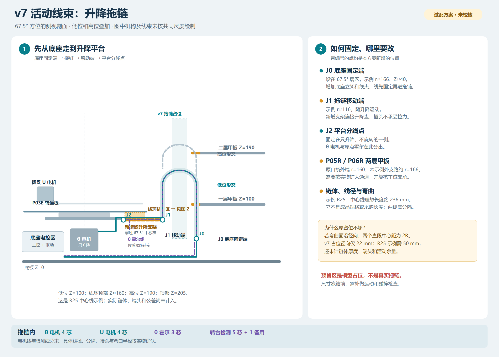
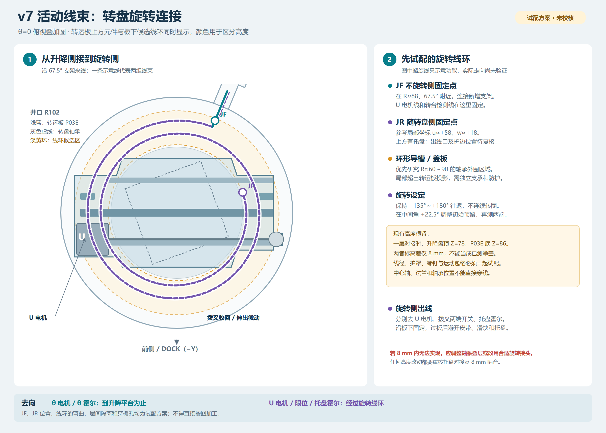
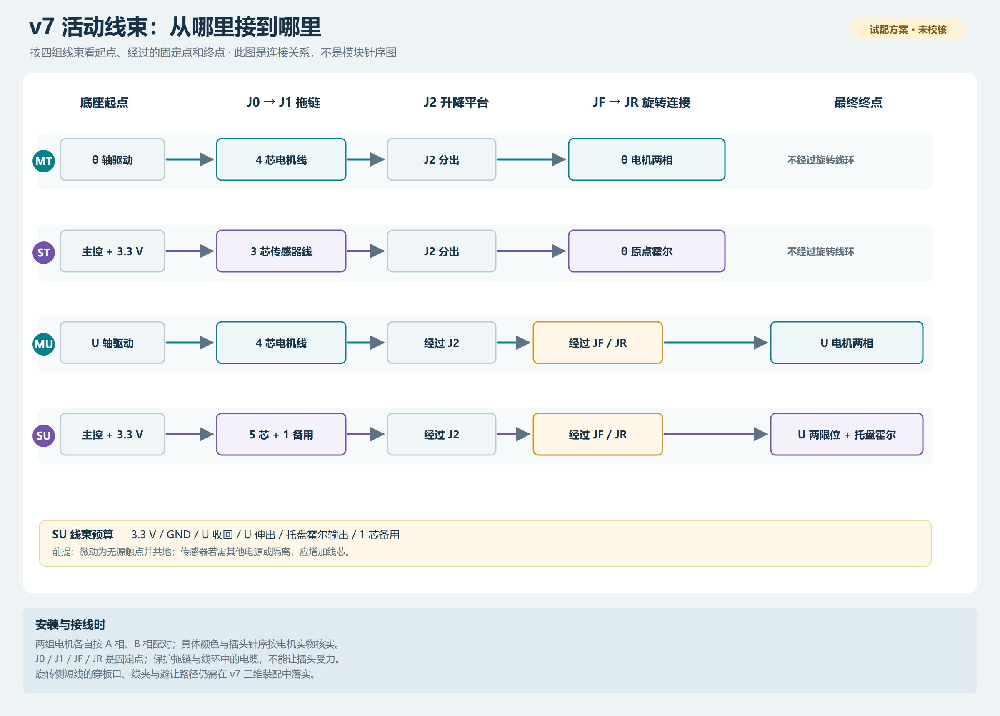

# v7 升降拖链与旋转连接：走线试配方案

日期：2026-11-06。以 [v7 机械试配](../三维装配_v7_加厚夹带/README.md) 为基准，一层样机先做，并兼顾第二层。图中的线束、拖链、支架、连接器、穿线孔和线环均为**新提出的方案**，不是现有 CAD 零件；尺寸不得直接用于加工或采购。现有 v7 装配和板件图未改动。

2026-11-07 更新：初版三维试配发现甲板、导向环及线夹等处相交，记录见[初版三维复核](../三维装配_v7_走线复核完成/README.md)。下方原示意图保留作为走线关系参考。

后续已调整相关结构并复查运动边界；最新模型和注意事项见[走线优化与安装复核](../三维装配_v7_走线优化安装复核/README.md)。

| 图片 | 内容 |
|---|---|
| [升降拖链走线 PNG](01_升降拖链走线.png) / [可放大的 SVG](01_升降拖链走线.svg) | 底座到升降平台的侧视、低位/高位、固定点及甲板改动 |
| [旋转连接走线 PNG](02_旋转连接走线.png) / [可放大的 SVG](02_旋转连接走线.svg) | 轴承外围候选线环、两侧固定点和旋转侧出口 |
| [线束终点和芯数 PNG](03_线束终点和芯数.png) / [可放大的 SVG](03_线束终点和芯数.svg) | 四组线束从底座到各电机、开关和霍尔的连接关系 |







## 一、整体路径

```text
底座电控：主控、θ 驱动、U 驱动
      │
      ├─ J0 底座固定端与线夹
      │      ↓  67.5° 方向的竖向拖链
      └─ J1 拖链移动端与新增随升降支架
             │
             ├─ J2 平台分线点 → θ 电机 4 线
             │                 → θ 原点霍尔 3 线
             │
             └─ JF 旋转线环固定侧 → 受约束柔性线环 → JR 随转盘侧
                                                    ├─ U 电机 4 线
                                                    ├─ U 收回 / 伸出微动
                                                    └─ 转运台托盘霍尔
```

θ 电机机身随升降、不随转盘旋转；其线到 J2 后结束。U 电机及两个微动开关固定在转运板上，随转盘旋转，但不随拨叉滑块平移，因此无需额外跟随拨叉的 138 mm 行程。θ 原点霍尔建议固定于升降侧，触发磁铁固定于转盘侧；实际传感器及支架位置需重新设计。转运台托盘霍尔及其座也尚未建模。

J0/J1 是线束机械固定点；J2 是升降平台分线点；JF/JR 是旋转线环两端的固定点。必要的可拆插头可以布置在被牢固支撑的非活动位置，不依赖插头承受拉力。图示入口、出口及中间线环是功能关系，不是已经证明不会相交的电缆轨迹。

## 二、67.5° 升降拖链

### 1. 用一组试算参数看空间

以底板上表面为 Z=0，ZL 为中央托盘支撑面的高度。此组参数仅用于发现空间冲突：

| 项目 | 试配假设 | 说明 |
|---|---|---|
| 布置方向 | θ=67.5° 径向面内做竖直 U 弯 | 若改弯曲面或拖链形状，下面的径向宽度需重算 |
| J0 固定端 | r=166、Z=40 | 约 X=63.5、Y=153.4；需新设底座立架，不是现有固定孔 |
| J1 移动端 | r=116、Z=ZL−27 | 约 X=44.4、Y=107.2；通过新支架连接升降中心盘 |
| 弯曲半径 | 中心线 R=25 | 仅演示，不代表实物拖链或线材允许此半径 |
| 转弯圆弧中心高度 | 一层 ZL=100 时为 Z=135 | 此姿态的理想中心线全长约 235.5 mm；不包含端头、过渡、链体厚度及余量 |

把拖链中心线简化成“两条竖直段 + 一个半圆”，两端径向间距为 2R=50 mm。一层对接时 J1 的 Z=73，低位中心线的最高处为 Z=160；二层对接时 J1 的 Z=163、最高处约 Z=205。若按 v7 名义机械止挡范围 ZL=86…194 计算，中心线最高处约 Z=153…207，实际链体外包络更大。这不是实际拖链运动仿真，也不是裁线/采购长度。

v7 仅画了 `r=130…152、切向 −7…+7、Z=40…250` 的长方体占位。即使不计链体厚度，试算的两条中心线位于 r=116 和 r=166，也已超出该范围。所选拖链的弯曲半径、外形、节距、移动端约束与实际线材都确认后，应重算并检查全行程。

### 2. 需要新增 / 调整

1. **底座立架**：在 67.5° 方位增加 J0 固定座及线夹，并核对其与底板、车位、框架和升降电机安装空间。
2. **移动端支架**：从不旋转的升降中心盘接至 J1。v7 原有支撑臂位于 22.5°、112.5°、202.5°，没有 67.5° 移动端支架；需设计新的安装件、强度、紧固方式和线夹。固定位置不能干扰转盘及其螺钉。
3. **甲板通道**：原 P05R/P06R 的 67.5° 槽口在 r≈102…125 处切向宽 14 mm，在 r=125…160 处宽 26 mm。图中 R25 示例的外侧中心线为 r≈166，已经超出口袋外端，内侧移动支架也会经过窄口。应在确定真实链体外包络后重画两层甲板通道，并复核相邻托盘、甲板强度和支承；不能把示意图中的虚线当成切割尺寸。
4. **拖链与线材**：按实际线径、动态弯曲半径、填充率及移动行程选型；电机线和检测线分束、必要时隔舱，并保证线束沿链内自由弯曲、不在链节内强行拉直。电机两相分别成对布置。

## 三、转盘旋转侧：候选平面线环

旋转范围暂沿项目原方案限制为 −135°…+180°，不能连续绕圈。设计方向是：在升降盘上的 JF 固定一端，在 P03E 转运板上的 JR 固定另一端；两端间用带导向和限位的柔性平面线环，随往返旋转逐渐收放。

| 点 / 区域 | 试配位置 | 要求 |
|---|---|---|
| JF 固定侧 | 67.5° 方位、r≈88 | 与新增升降侧支架连接，不接到会旋转的 P03E 上 |
| JR 旋转侧 | P03E 局部坐标 `u≈+58、w≈+18`，θ=0 时距中心约 60.7 | 此点上方有转运托盘；仅供寻找位置，穿板孔、护口、接头、托盘净空和线夹均须复核 |
| 候选导槽 | 相对于转轴约 r=60…90 的区域 | 局部超出 P03E 板面投影，需补独立支承、盖板及防夹；不得假定已有完整的板底可供粘贴 |

一层对接时，v7 升降盘顶面 Z=78，P03E 底面 Z=86，**两者标高差只有 8 mm**。转盘下板、滚道、上板、紧固件及真实轴承形状还会占用其间部分空间；在候选半径上也不一定都有上下板面。因此 8 mm 只是名义标高差，不是已经可用的线槽净高。中心轴、法兰和隔套已占用中心，不能假定从中心穿线。

图中螺旋仅表达“储备长度随转角变化”，**圈数、线长、滑动方式和是否能容纳两组线均未确定**。应分别为电机和传感器线路选择适合反复弯曲的线材，设计导槽隔离、固定方式和防磨护罩；在中间角 +22.5° 设置初始状态，分别验证 −135° 和 +180°，以及所有中间位置和往返顺序，防止绷紧、叠压、扭结或脱槽。线环外侧、两端出线及软线的动态包络也要算入 R102 井口和停放托盘的净空。

JR 分出后，在旋转侧引往 U 电机、U 两端开关及托盘霍尔，短线需固定、加护边，并避开皮带、带轮、滑块、支撑条及托盘。图示没有给出已验证的各个穿板点。若 8 mm 的现有叠层无法容纳，需要重新设计转盘叠层，或另行选型及安装旋转接头；涉及升降/转台高度变化时，须同时复核对接高度、8 mm 啮合 / 脱开及层间净空。

## 四、各线接到哪里

本表是**信号级**关系；驱动模块和电机插头的实际物理针序仍以实物与万用表核对后的逐针表为准。线芯数量是方案预算，线材外径、电压、电流、屏蔽及连接器尚未确定。

| 线束 | 起点 → 终点 | 穿过拖链 | 穿过旋转线环 |
|---|---|---|---|
| MT：θ 电机 | 底座 θ 驱动 A+/A−、B+/B− → θ 电机两相绕组 | 4 芯 | 不经过 |
| MU：U 电机 | 底座 U 驱动 A+/A−、B+/B− → U 电机两相绕组 | 4 芯 | 4 芯 |
| ST：θ 原点 | 主控 3.3 V、GND、输入 → θ 原点霍尔 | 3 芯 | 不经过 |
| SU：转台检测 | 3.3 V、GND、收回开关、伸出开关、托盘霍尔输出，另预留 1 芯 | 6 芯 | 6 芯 |

合计拖链按 **17 芯**作初步空间预算，旋转线环按 **10 芯**预算。SU 数量以两只无源微动共用地、一个 3.3 V 霍尔且不需额外隔离为前提；实际模块若需要独立供电或其他信号，须增加。各电机相线断电测量配对；驱动器配置、电机相序、回零传感器选型与主控 GPIO 参见[电气接线初审](../../电气接线与走线初审_v1.md)。

## 五、验证和冻结顺序

1. 确认拖链和柔性线材实物的外径、额定动态弯曲半径、连接器尺寸及板卡/电机型号。
2. 在现有 v7 模型中补画实际链体、上下端头、J0/J1 支架、电缆、JF/JR、旋转线环、护罩和传感器座；对两个 Z 极限、八个方位以及完整往返过程检查，尤其甲板过孔、托盘、皮带和转盘轴承。
3. 用实物线材先做不承载的拖链和旋转线环小样，验证最低 / 最高位置及 −135°…+180° 全行程；测电缆应变与固定夹受力，检查是否磨边、压扁、拉紧或松脱。
4. 结合实际包络修订 P05R、P06R、P03E、支架和接线表，再裁线并在断电状态下逐芯核对。之后依次进行低速空载、带载和重复循环试验。

**已完成**：对照 v7 建模脚本、实体范围与板件几何整理走线、R25 中心线试算和上述三张示意图。

**后续仍未完成**：实际拖链选型、真实电缆动态包络、精确连续干涉求解、加工图、实物试配、线径/线长及通电验证。几何试配检查及其限制见上方的三维复核链接。

相关依据：[v7 装配说明](../三维装配_v7_加厚夹带/README.md)、[v7 板件说明](../图纸_v7_加厚夹带/README.md)、[v7 装配生成脚本](../../../tools/create_garage_assembly_v7.ps1)、[v7 甲板图生成脚本](../../../tools/create_cad_v7.ps1)。示意图可用 `py tools/create_wiring_diagrams_v7.py` 重绘 SVG；PNG 是 SVG 的视图输出。
